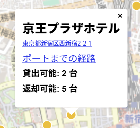
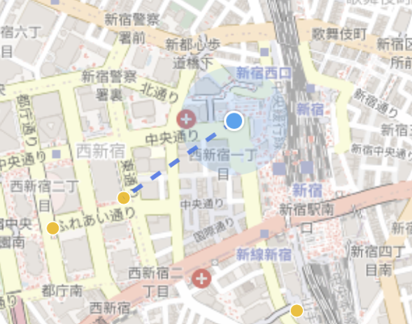

# シェアサイクル空き状況ビューア  
**URL**: https://cycling-map-three.vercel.app/

## これはなに？
- ODPTを通じて公開されているHELLO CYCLINGのGBFSデータを取得し，ポートの状況を地図上で確認できるWeb地図です。
 

## できること
### ベースマップの切り替え
- 地理院地図 淡色地図とOpenStreetMapの2種類から選べます。
### 表示物の選択
- デフォルトで表示されている利用可能ポート，返却可能ポート，そしてズームアウト時に表示されるポートのヒートマップを非表示にすることができます。
### 利用可能，返却可能台数の表示
- そのポートで借りられる，および返せる車両台数を表示することができます。
### ポート位置，経路の検索
- GoogleのMaps URLsを使用し，選択したポートの場所と現在地からそのポートへの経路を調べることができます。

### 最寄りポートの探索
- 位置情報をオンにすると，最寄りの利用可能ポートまで直線が描画されます。

---

## 制作の背景
- 「[位置エン本](https://www.shuwasystem.co.jp/book/9784798068923.html)」の演習を経て，興味のあるシェアサイクルとコラボレーションさせてみよう！ということで試作してみました。

## 技術スタック
| カテゴリ | 使用技術 |
| :--- | :--- |
| フロントエンド | HTML / CSS / JavaScript / Vite |
| 地図ライブラリ | MapLibre GL JS |
| バックエンド | Vercel Serverless Functions |

## 使用データ
- GBFS: 
[OpenStreet株式会社 / 公共交通オープンデータ協議会(HELLO CYCLING)](https://ckan.odpt.org/dataset/c_bikeshare_gbfs-openstreet)
- OpenStreetMap: [© OpenStreetMap contributors](https://www.openstreetmap.org/copyright)
- 淡色地図: [国土地理院 地理院タイル](https://maps.gsi.go.jp/development/ichiran.html)

## 免責事項
本アプリで表示されるポートの空き状況は，実際の現地状況と異なる場合があります。